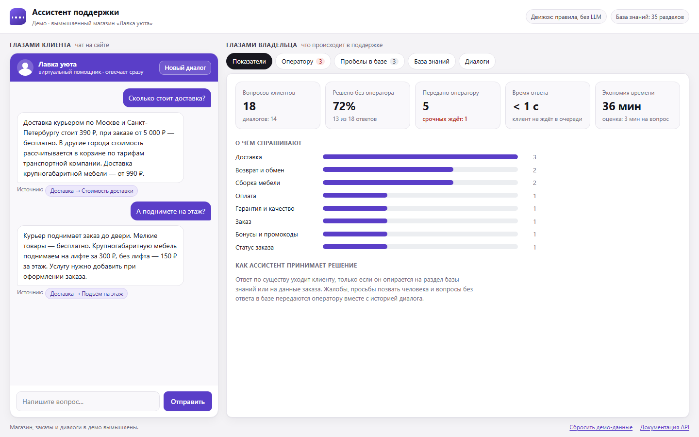
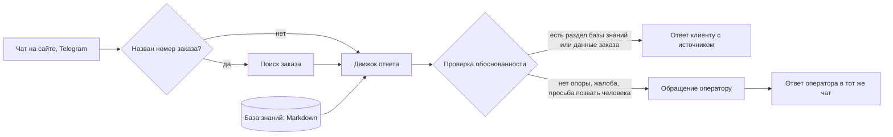

# Ассистент поддержки

Чат-ассистент, который отвечает клиентам по базе знаний компании, подсказывает статус заказа
и передаёт оператору всё, что не должен решать сам. Работает в чате на сайте и в Telegram.
Владелец видит, сколько вопросов закрыто без оператора и каких ответов не хватает в базе знаний.

> Демо-проект. Магазин «Лавка уюта», заказы, диалоги и контакты вымышлены.



## Какую задачу решает

Большая часть обращений в поддержку повторяется: сколько стоит доставка, как вернуть товар,
где мой заказ. Операторы тратят на них день, а ночью и в выходные клиенту не отвечает никто.

| Было | Стало |
|---|---|
| Клиент ждёт оператора в очереди | Ответ на типовой вопрос приходит сразу, в любое время |
| Оператор десятый раз за день пишет про доставку | Оператор занимается жалобами и нестандартными случаями |
| Ответы зависят от того, кто на смене | Ответы берутся из одной базы знаний, со ссылкой на раздел |
| Никто не знает, о чём спрашивают чаще всего | Темы вопросов и пробелы базы знаний видны на панели |

## Как это работает



1. **База знаний** — обычные текстовые файлы в `data/kb`, по одному на тему. Владелец правит
   их сам. У каждого раздела есть строка с типичными формулировками вопросов: она помогает
   поиску, но не показывается клиенту.
2. **Движок ответа** возвращает ответ по схеме: действие (`answer`, `clarify`, `smalltalk`,
   `escalate`), текст, разделы-источники, причина передачи оператору. Движков два:
   - `claude` — Claude получает всю базу знаний в системном промпте (он кэшируется) и историю
     диалога, поэтому понимает вопросы в свободной форме и уточняющие реплики;
   - `rules` — поиск BM25 по базе знаний и готовый текст раздела в ответ. Работает без
     интернета, понимает формулировки, близкие к базе.
3. **Проверка обоснованности** (`app/assistant.py`) выполняется кодом после любого движка.
   Ответ по существу уходит клиенту, только если ссылается на существующий раздел базы знаний
   или на найденный заказ. Выдуманные идентификаторы отбрасываются, ответ без опоры
   заменяется передачей оператору.
4. **Заказы.** Номер заказа ищется до обращения к движку, и в ответ попадают только статус
   и состав. Адрес, телефон и сумма по одному номеру не раскрываются.
5. **Передача оператору.** Жалобы получают пометку «срочно». Оператор отвечает из панели,
   ответ приходит клиенту в тот же чат (в Telegram его доставляет бот).

## Что можно показать на демо

- вопрос из базы знаний: ответ с кнопкой-источником, которая открывает нужный раздел;
- «Где мой заказ 10482?»: статус с датой; «Где мой заказ?» → уточнение номера → ответ;
- вопрос не по базе: ассистент честно передаёт его оператору, обращение появляется справа;
- ответ оператора из панели приходит в чат слева;
- вкладка «Пробелы в базе»: какие вопросы остались без ответа и сколько раз их задали;
- показатели: доля вопросов, решённых без оператора, темы обращений, оценка экономии времени.

## Быстрый старт

Нужен Python 3.10+.

```bash
pip install -r requirements.txt
python run.py
```

Откройте http://127.0.0.1:8103. Без ключа API демо работает на движке правил.

Чтобы отвечал Claude, скопируйте `.env.example` в `.env`, впишите `ANTHROPIC_API_KEY`
и перезапустите.

| Команда | Что делает |
|---|---|
| `python run.py --reset` | пересоздаёт демо-историю диалогов |
| `python telegram_bot.py` | запускает Telegram-бота (нужен `TELEGRAM_BOT_TOKEN`) |
| `python -m pytest` | запускает тесты |
| `python scripts/evaluate.py` | измеряет качество движка правил |
| `python scripts/evaluate.py --engine claude` | измеряет качество Claude (44 платных запроса) |

## Измеренное качество

Вопросы размечены вручную: какое действие ожидается и на какой раздел должен опираться ответ.
`dev` — 26 вопросов, на которых настраивались синонимы и порог поиска. `holdout` — 18 вопросов
в разговорных и перефразированных формулировках, в настройке не участвовали.

Движок правил (`python scripts/evaluate.py`):

| Показатель | dev (26) | holdout (18) |
|---|---|---|
| Верное действие | 100% | 61% |
| Верный источник (вопросы с ответом в базе) | 100% | 42% |
| Ложные ответы: ответил там, где нужен оператор | 0 | 0 |
| Лишние передачи оператору | 0 | 7 |

Вывод: поиск по словам безошибочен на привычных формулировках и теряется на перефразированных
(«сам соберу, гарантия не слетит?»). Важно, как именно он ошибается: не отвечает неправильно,
а зовёт оператора. Ложных ответов нет ни на одном наборе, потому что порог поиска и проверка
обоснованности настроены на осторожность.

Качество Claude в этом репозитории не зафиксировано: его нужно измерить на своём ключе командой
выше. Скрипт покажет те же показатели, среднее время ответа и стоимость прогона.

## Каналы и интеграции

| Канал | Как подключается |
|---|---|
| Чат на сайте | `POST /api/chat` с текстом и номером диалога; описание в `/api/docs` |
| Telegram | `python telegram_bot.py`, токен бота в `.env` |
| Данные заказов | модуль `app/orders.py`: в демо читает JSON, в проекте заменяется запросом в CMS или CRM |

Telegram-бот покрыт тестами на подменённом HTTP-транспорте. С настоящим ботом в рамках демо
он не запускался.

## Настройка под компанию

| Что меняется | Где |
|---|---|
| Тексты ответов и типичные вопросы | `data/kb/*.md` |
| Название, приветствие, быстрые вопросы | `data/company.json` |
| Тон и правила ответов модели | `app/engines/claude.py`, функция `build_system_prompt` |
| Синонимы и порог поиска базового движка | `app/kb.py`, `app/engines/rules.py` |
| Источник данных о заказах | `app/orders.py` |
| Проверочные вопросы | `data/eval_*.json` |

## Устройство проекта

```
app/
  kb.py               разделы из Markdown и поиск BM25
  assistant.py        заказ → движок → проверка обоснованности
  engines/claude.py   ответ Claude по базе знаний, строго по схеме
  engines/rules.py    ответ без LLM
  orders.py           поиск заказа и описание статуса
  service.py          диалоги, обращения к оператору, статистика, пробелы базы
  telegram.py         канал Telegram
  db.py               SQLite
  main.py             HTTP API
  static/             чат и панель владельца (без сборки и фреймворков)
data/kb/              база знаний: 8 тем, 35 разделов
scripts/evaluate.py   оценка качества
tests/                30 тестов
```

## Стоимость и надёжность

- По умолчанию используется `claude-opus-5-5` с `effort=low`; модель задаётся в `.env`.
- База знаний и инструкции идут одним кэшируемым блоком: повторные запросы оплачиваются
  по цене чтения из кэша. Стоимость каждого ответа считается по `usage`.
- Включён серверный fallback для моделей, которые его поддерживают: если классификатор
  безопасности отклонит запрос, API повторит его на запасной модели в том же вызове.
- Если API недоступно, отвечает движок правил; в худшем случае вопрос уходит оператору.
- В системном промпте сообщения клиента объявлены данными, а не инструкциями. Главная защита
  при этом не промпт, а код: без источника ответ клиенту не уходит.

## Ограничения демо

- Вся база знаний передаётся в промпт: это подходит для десятков страниц. Для сотен страниц
  перед запросом добавляется отбор разделов (поиск уже есть в `app/kb.py`).
- Нет авторизации панели владельца и ограничения частоты запросов в чате.
- Статус заказа выдаётся по одному номеру. Для выдачи адреса или суммы нужна проверка клиента,
  например по последним цифрам телефона.
- Ассистент не оформляет возвраты и не меняет заказы: он объясняет порядок и зовёт оператора.
- Диалоги уходят во внешнее API. Для персональных данных клиентов это нужно согласовать
  с политикой компании и требованиями 152-ФЗ.
